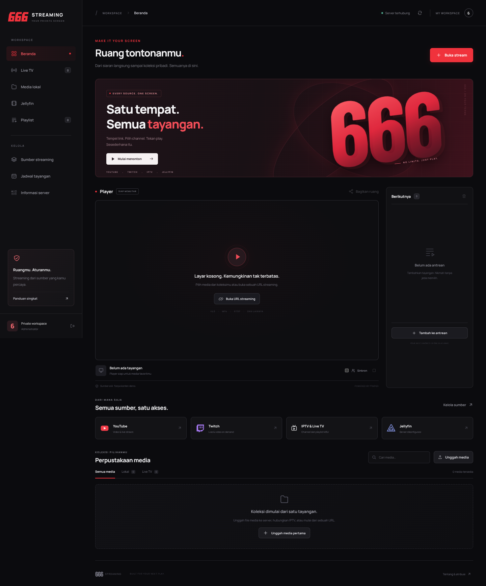

<p align="center"></p>

# 666 Streaming

**Your private screen.** Dashboard streaming privat hitam/merah/putih dengan backend **JavaScript ES Modules, Node.js 22**, Express, WebSocket, FFmpeg, dan **discord.js v14**. Migrasi dilakukan pada arsitektur/provider/source yang sudah ada—bukan dashboard demo pengganti.



> **Tidak ada runtime aplikasi Python atau launcher Python.** `npm start` langsung menjalankan `node src/index.js`. Sesuai persetujuan pengguna, **yt-dlp mandiri** tetap dipakai sebagai utilitas eksternal: tidak perlu Python/pip sistem, tetapi binary tersebut membawa CPython internal. Jangan menyebut seluruh toolchain “tanpa interpreter sama sekali”.
>
> **Discord resmi saja.** Bot menangani slash command dan voice **audio**. Video dimainkan melalui browser HLS; official Bot API tidak menyediakan native Go Live/screenshare. Tidak ada selfbot, user token, private gateway patch, atau jaminan lip-sync audio bot dengan browser.

## Fitur

- HLS nyata dari video/audio lokal, upload, URL HTTP(S), IPTV/M3U, XMLTV, RTSP/RTMP yang didukung FFmpeg.
- YouTube/Twitch dan extractor yt-dlp lain: live → URL A/V; VOD → unduhan terbatas sebelum playback. Bukan bypass DRM/paywall/login.
- TVheadend: channel, Basic Auth, EPG, now-playing dan penjadwalan.
- Jellyfin: film/serial, pilihan season/episode, `Judul S01E02`, PlaybackInfo H.264/AAC tanpa subtitle.
- Player responsif: play/pause/seek/volume/fullscreen, antrean, urutan playlist persisten, error/loading dan upload sungguhan.
- Watch room berpassword, sinkronisasi play/pause/seek antarbrowser secara opt-in (bukan frame-perfect).
- JSON privat atomik yang kompatibel dengan data sumber/playlist lama; tidak perlu MongoDB/Redis.
- Slash command dengan allowlist admin/operator, audio Opus resmi, auto-leave dan jadwal acara 30 detik lebih awal.
- Satu port HTTP + WS, `HOST=0.0.0.0`, port allocation Pterodactyl, child-process timeout/abort dan SIGINT/SIGTERM cleanup.

**Status teruji dan batas paritas** ada di [TESTING](docs/TESTING.md) dan [FEATURES](docs/FEATURES.md). Layanan luar tidak menjadi “lulus” hanya karena adapter-nya tersedia. Tidak ada channel atau konten demo bawaan.

## Instalasi cepat — Linux

Prasyarat: **Node.js 22.17+ pada major 22**, npm, FFmpeg **dan** FFprobe dengan encoder H.264/AAC. Tidak perlu python, pip, venv atau database. Voice memakai Opus/WASM dan dependency DAVE dari @discordjs/voice.

```bash
# Administrator Debian/Ubuntu; bukan perintah untuk console shared panel:
sudo apt-get update && sudo apt-get install -y ffmpeg ca-certificates

# Di direktori source:
npm ci --include=dev
npm run build
npm run install:ytdlp
cp .env.example .env
# Edit .env: APP_PASSWORD, SERVER_PORT/PORT, PUBLIC_URL bila diperlukan.
npm run check
npm start
```

Installer mengunduh asset **standalone platform** dari rilis resmi yt-dlp dan mencocokkan SHA-256. File bernama `yt-dlp` tanpa suffix pada halaman rilis adalah zipapp Python, **bukan** yang boleh dipasang. Jika host memblokir GitHub release assets, ikuti [instalasi binary manual](docs/INSTALLATION.md#yt-dlp-mandiri).

Password kosong dibuat sekali di `DATA_DIR/initial-password` (mode `600`), tidak ditulis di console/API. Baca hanya melalui file manager/terminal host. Untuk produksi gunakan password panjang, HTTPS dan `COOKIE_SECURE=true`.

```bash
# Startup langsung untuk process manager / Pterodactyl (signals ke Node):
node src/index.js
```

`npm run check` benar-benar menguji video, AAC, pembuatan dan pembacaan HLS dengan kedua binary, serta yt-dlp mandiri. Jika extractor belum dipasang, web/local/direct/IPTV tetap dapat berjalan, tetapi check berstatus gagal dan YouTube/Twitch belum siap.

## Pterodactyl / Docker

Pakai **image Node 22 kustom dari [Dockerfile](Dockerfile)** yang menyertakan FFmpeg, FFprobe, dependency npm produksi dan yt-dlp mandiri. Tidak ada tahap pip atau base image Python.

1. Administrator membangun/mempublikasikan image, lalu mengimpor [egg](deploy/pterodactyl/egg-666-streaming.json).
2. Primary allocation TCP → `SERVER_PORT`; biarkan `PORT` kosong dan `HOST=0.0.0.0`.
3. Startup: **`node src/index.js`**. Atur password, URL publik, HTTPS/WS dan provider lewat environment.
4. Image menyalin source/dependency/aset ke volume kosong sekali saja; konfigurasi/data yang ada tidak ditimpa saat restart.
5. Jalankan preflight, `/healthz`, dan tes media sendiri di Wings. **Image/egg belum diuji pada Docker daemon atau Wings nyata di sandbox ini.**

[**Panduan Pterodactyl lengkap →**](docs/PTERODACTYL.md)

Memakai egg Node generik dengan kolom **MAIN FILE / GIT REPO / USER UPLOADED FILES**? Ikuti [isian panel langkah demi langkah](docs/PTERODACTYL.md#c-isian-egg-nodejs-generik-seperti-screenshot-panel) dan [preset `.env` panel](deploy/pterodactyl/.env.example). Pilih **Node22, bukan Node25**, dan MAIN FILE **`src/index.js`**. ZIP sudah membawa aset build; clone Git memerlukan `npm run build` setelah pemasangan dependency dev. Console aplikasi tidak selalu merupakan shell untuk menjalankan npm/apt.

```bash
cp .env.example .env
# Isi .env sebelum start.
docker compose up -d --build
docker compose logs -f
```

Compose menggunakan volume `streaming666-data`. Tidak ada klaim image sudah dipublikasikan ke registry.

## Discord resmi (opsional)

- Buat application **bot**, undang dengan scope `bot` + `applications.commands`.
- Isi `DISCORD_BOT_TOKEN`, `ALLOWED_USER_IDS` (admin) dan `OPERATOR_USER_IDS` (playback). ID diperlakukan sebagai string, bukan angka JavaScript.
- Hanya intents Guilds + GuildVoiceStates; **Message Content/Members privileged intent tidak diperlukan**.
- Izin voice: View Channel, Connect, Speak. Stage harus mengizinkan bot menjadi speaker. Jaringan hosting harus mengizinkan Discord HTTPS/WebSocket dan outbound UDP.
- `DISCORD_GUILD_IDS` opsional untuk registrasi slash segera di guild pengembangan; kosong = global, ada waktu propagasi Discord.

| Akses | Perintah |
|---|---|
| Viewer anggota guild | `/help`, `/ping`, `/channels query page`, `/sources` |
| Operator/admin | `/join`, `/leave`, `/stop`, `/play query`, `/search query`, `/media query` |
| Admin | `/hello`, `/add-source name url`, `/sources action:enable\|disable name`, `/delete-source index` |

`/play` menerima URL, nama/nomor/ID channel, atau `local:namafile.mp4`. `/media` memakai menu pilihan dan sintaks episode. `/search` memainkan acara aktif atau meminta konfirmasi jadwal ≤24 jam; saat jadwal dimulai, peminta harus masih di voice. Respons command privat; link `/watch/…` boleh dibagikan, tetapi penonton tetap perlu password workspace. Jadwal panjang mengirim notifikasi DM karena token interaction kedaluwarsa. Prefix `!` dan perintah DM digantikan slash guild agar tidak membutuhkan pembacaan pesan pengguna.

## Tes

```bash
npm run check:source
npm run lint
npm run build
npm test
npm run test:browser
npm audit --omit=dev
```

Tes media memerlukan FFmpeg/FFprobe dan standalone yt-dlp yang benar; jika tidak tersedia tes gagal, bukan diganti hasil palsu. `FFMPEG_PATH`, `FFPROBE_PATH`, `YTDLP_PATH` dapat menunjuk binary test di lokasi lain. Chromium hanya dev dependency. [Laporan dan batas verifikasi →](docs/TESTING.md)

Hasil verifikasi terakhir: **158/158 tes Node**, **5 kelompok browser E2E**, serta **31/31 tes smoke setelah instalasi production-only**, semuanya dari ekstraksi source tanpa `.git`. Syntax/import 45 file, lint/build dan audit dependency produksi juga lulus (0 vulnerability terlapor saat diperiksa). Media benar-benar di-encode/decode; provider terkontrol tidak disebut sebagai provider eksternal yang sudah berhasil. Build dari export commit Git bersih juga diuji, termasuk logo/favicon source yang harus ikut Git. Status CI commit terbaru ada pada Checks PR.

## Membuat distribusi source

```bash
npm run build
npm run archive
(cd artifacts && sha256sum -c 666-streaming-javascript-source.zip.sha256)
```

ZIP JavaScript menyertakan source, lockfile, aset web siap-serve, dokumentasi, laporan tes, egg dan LICENSE. **Tidak menyertakan** `.env`, data privat, node_modules, binary utilitas atau cache/source Python. Untuk memakai aset bawaan ZIP tanpa rebuild: `npm ci --omit=dev`, sediakan FFmpeg/FFprobe + yt-dlp mandiri, konfigurasi environment, lalu `npm run check` dan `node src/index.js`. Rebuild memerlukan dev dependencies. Arsip Python historis bukan paket versi ini.

## Dokumentasi

- [Audit sebelum migrasi dan pemetaan setiap modul Python → JS](docs/AUDIT-JAVASCRIPT.md)
- [Instalasi/update/migrasi data](docs/INSTALLATION.md)
- [Konfigurasi/keamanan](docs/CONFIGURATION.md)
- [Pterodactyl](docs/PTERODACTYL.md) · [Matriks fitur](docs/FEATURES.md)
- [Pipeline streaming](STREAMING.md) · [Pengujian](docs/TESTING.md)
- [Provenance/protokol historis](docs/PROTOCOL-REFERENCE.md) · [Atribusi](THIRD_PARTY.md)

## Lisensi & atribusi

666 Streaming adalah turunan **Slopsoil**, karya **topsoil / dev-topsoil**. [Source asli](https://github.com/dev-topsoil/slopsoil) dan [dukungan kepada pembuat asli](https://www.buymeacoffee.com/devtopsoil). [LICENSE](LICENSE) asli **tidak diubah**. Source historis tetap tersedia pada Git baseline; tidak disertakan sebagai runtime Python aktif. Nama lama hanya untuk atribusi/provenance. Gunakan hanya media yang berhak Anda akses.
